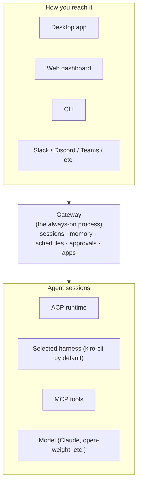
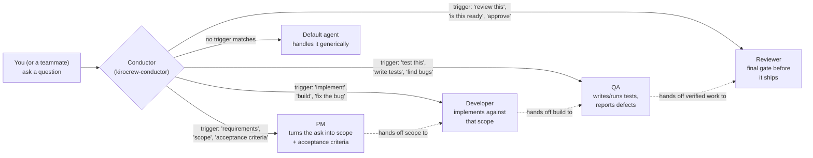
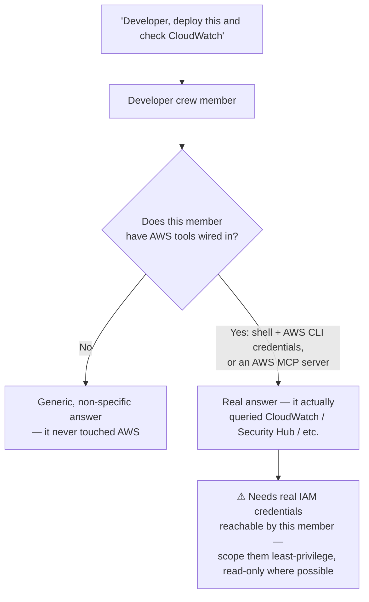
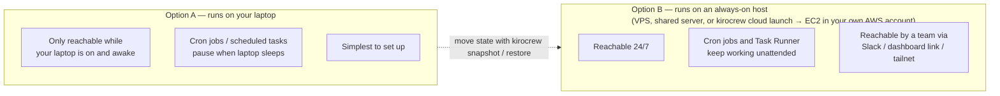
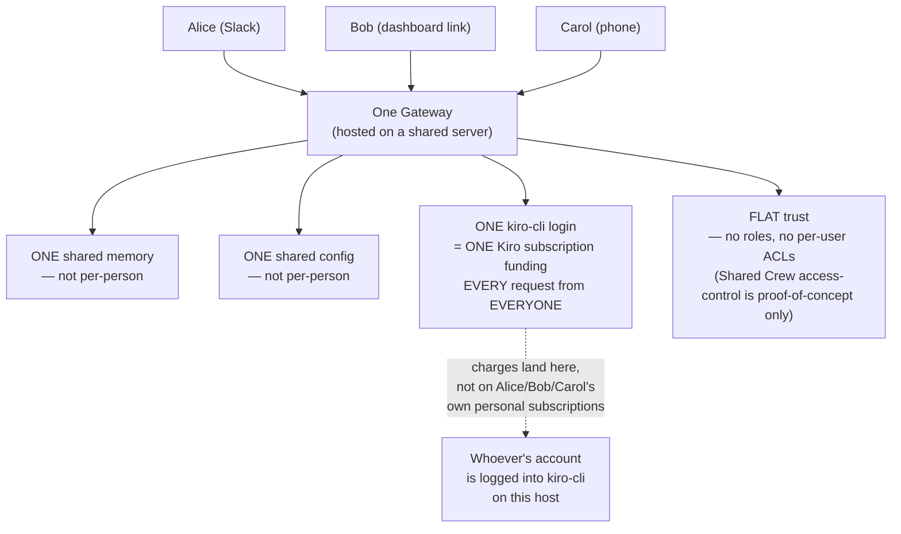
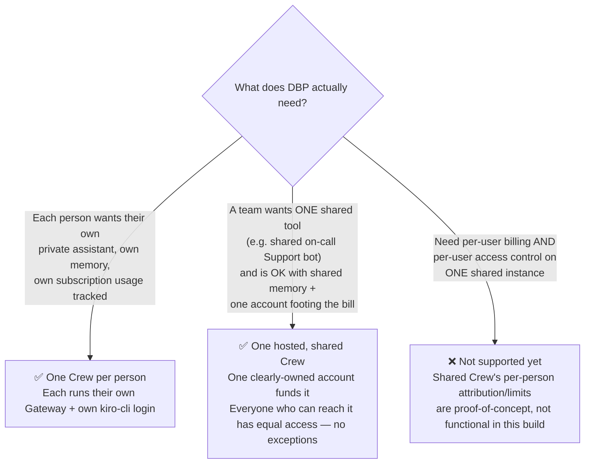

# Kiro Crew — Visual Guide

**Purpose:** see the shape of Kiro Crew before you explain it out loud. Pairs with `KiroCrew-Cheatsheet.md` (commands) and `Facilitator-Guide.md` (session run-sheet) in this folder.
**Rendering note:** the diagrams below are Mermaid — they render natively in GitHub, VS Code/Kiro IDE preview, and most modern markdown viewers.

---

## 1. The basic shape: one Gateway, many surfaces

**One thing to say out loud:** the Gateway is the actual product. Everything in "Surfaces" is just a window into the same underlying process, memory, and state. Closing the dashboard doesn't stop anything — the Gateway keeps running.

---

## 2. Inside the Gateway: a 4-role software delivery team

DBP's crew is modeled as a mini SDLC team: **PM → Developer → QA → Reviewer**. Each is a separate crew member (own workspace, own memory, own triggers); the conductor routes each message to whichever one the wording matches.

**One thing to say out loud:** PM, Developer, QA, and Reviewer are **config, not separate brains** — same underlying model unless you deliberately pin a different one per role. What makes them different is the workspace, memory, instructions, and tools each is bound to, and the trigger wording that routes a message to the right one. Pick trigger phrases that don't overlap — "test this" (QA) and "review this" (Reviewer) are deliberately distinct, not two words for the same thing.

---

## 3. Where real capability actually comes from (it's not automatic)

**One thing to say out loud:** this is the single most common false assumption people bring into this training. Flag it early. Note the 4-role team above has no dedicated DevOps/SRE member — if DBP wants real AWS deployment/troubleshooting handled by a specialist rather than bolted onto Developer, that's a 5th role to add later, not something these four give you by default.

---

## 4. Laptop vs. hosted: the deployment decision

---

## 5. The part people miss: what "sharing" actually shares

**One thing to say out loud:** sharing the link is easy. Sharing it *safely and with the right billing owner in mind* is the actual decision DBP needs to make, not a technical step.

---

## 6. Decision guide: one shared Crew, or one Crew per person?

---

## 7. Quick summary table

| Question | Answer |
|---|---|
| Can one Crew be reached by multiple people? | Yes — via Slack/Discord/Teams, a shared dashboard link, or a tailnet |
| Does each person's own Kiro subscription get used? | **No.** One `kiro-cli` login funds every request, regardless of who sent it |
| Is there access control between users on one shared Crew? | **No roles, no per-user ACLs today.** Everyone who can reach it has equal rights |
| Is memory/config shared or separate per person? | **Shared.** One memory store, one config, for everyone on that instance |
| Does it know how to troubleshoot AWS out of the box? | **No.** Only if a member has AWS CLI/credentials or an AWS MCP server explicitly wired in |
| Best setup for "everyone has their own AI assistant"? | One Crew per person, not one shared instance |
| Best setup for "the team wants one shared on-call bot"? | One hosted shared Crew, with one clearly chosen, properly-sized paid account behind it |